# MentorPi Research: 白線マスク時系列画像による走行速度推定と小型移動ロボット

小型移動ロボット（Hiwonder MentorPi A1 相当、アッカーマン操舵）を対象にした個人研究のコードです。

著者：栗原 旺愛（Akichika Kurihara, Independent Researcher）

- **白線画像生成ソフト（lane-synth）**：コースを走ったときの車載カメラの白線マスク画像と鳥瞰画像を合成
- **走行速度推定**：10 Hz の白線マスク時系列画像から現在の走行速度を推定し、3D CNN と 2D CNN を比較
- **ROS 2 パッケージ**：実機の起動・手動操縦・cmd_vel からモータ／ステア指令への変換

## 研究の概要（説明スライド）

<table>
<tr><td width="50%"><a href="docs/slides/slide-05.png">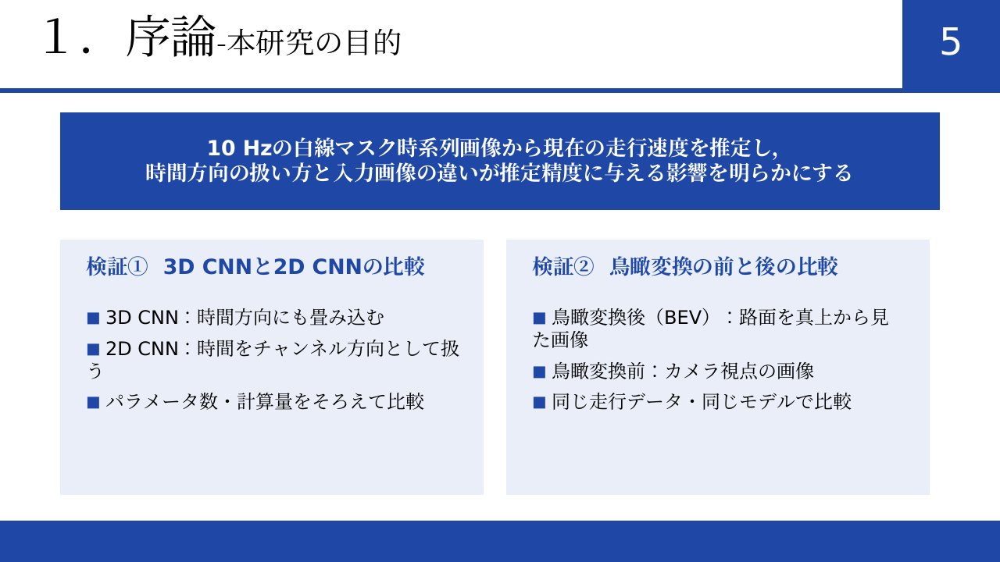</a> 本研究の目的</td><td width="50%"><a href="docs/slides/slide-10.png">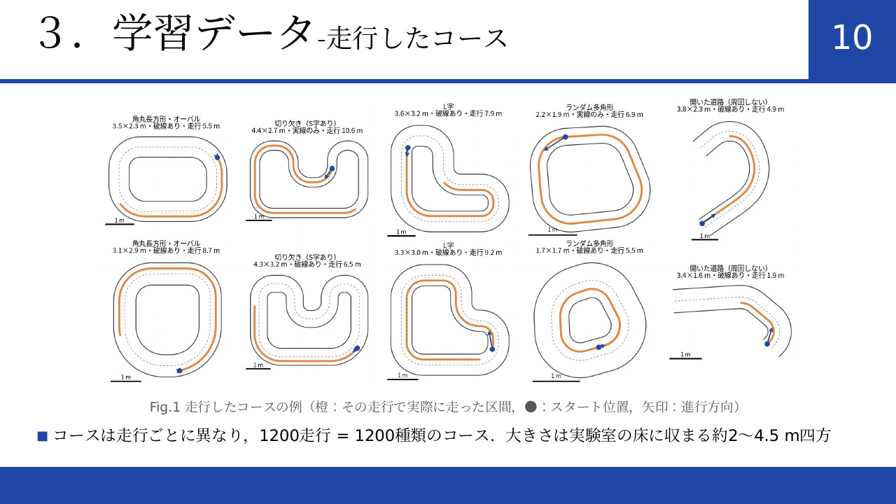</a> 走行したコース</td></tr>
<tr><td width="50%"> 入力画像の例</td><td width="50%"><a href="docs/slides/slide-19.png">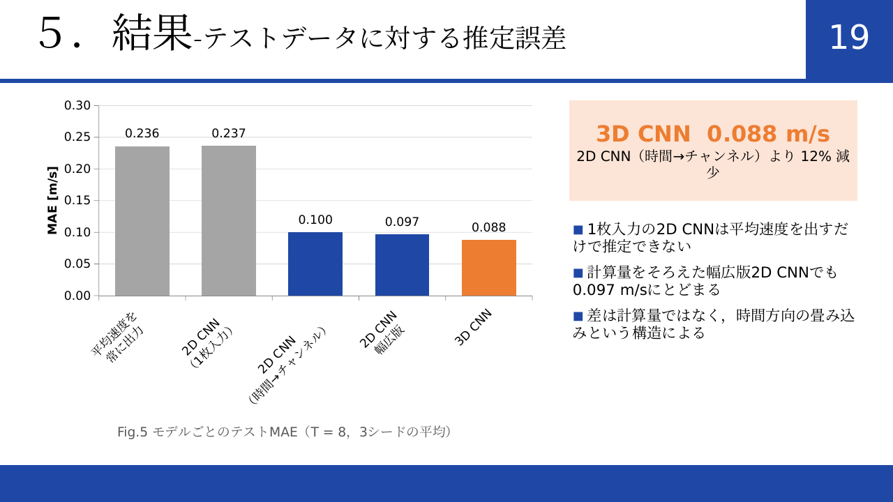</a> テストデータに対する推定誤差</td></tr>
<tr><td width="50%"><a href="docs/slides/slide-23.png">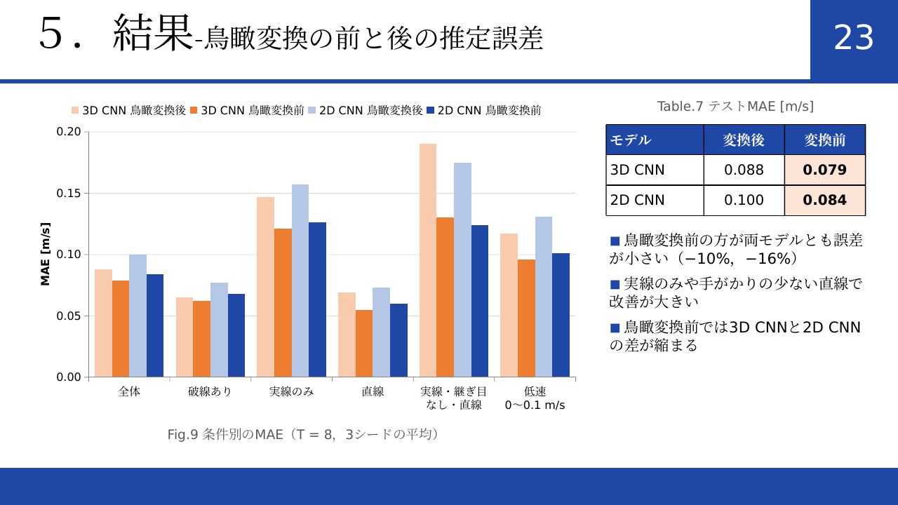</a> 鳥瞰変換の前と後の推定誤差</td><td width="50%"> まとめ</td></tr>
</table>

すべてのスライドを見る（19 枚）

**2. 目次**

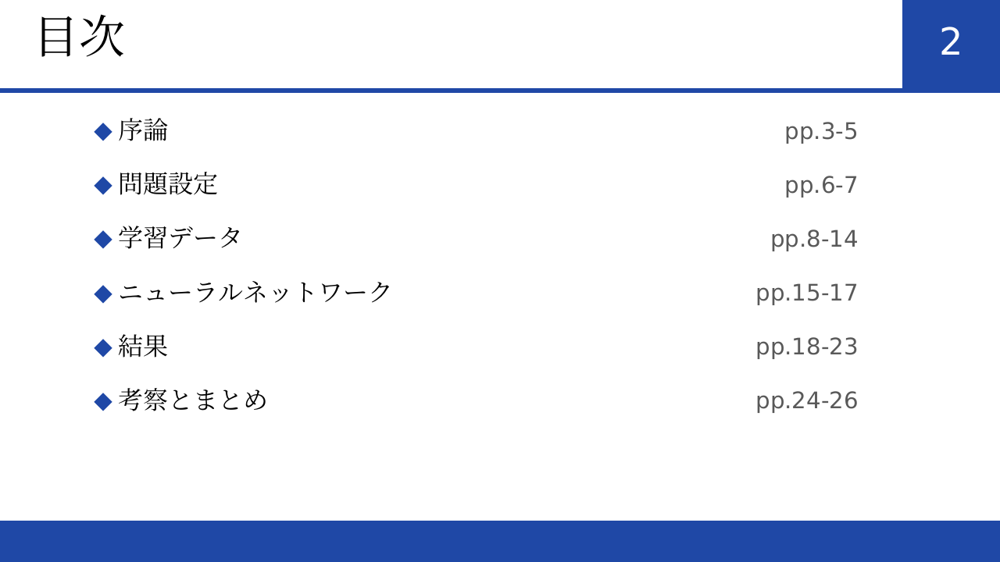

**4. 研究背景**

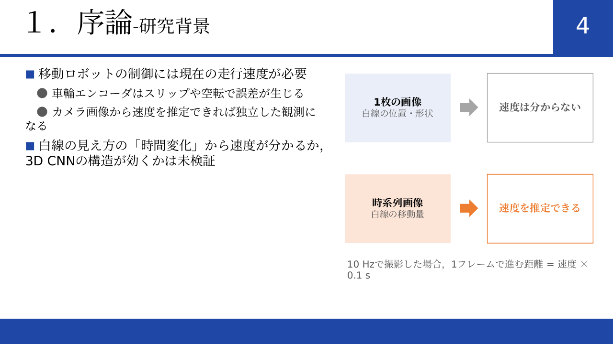

**5. 本研究の目的**

**7. 速度推定の流れ**

**9. 学習データの作成方法**

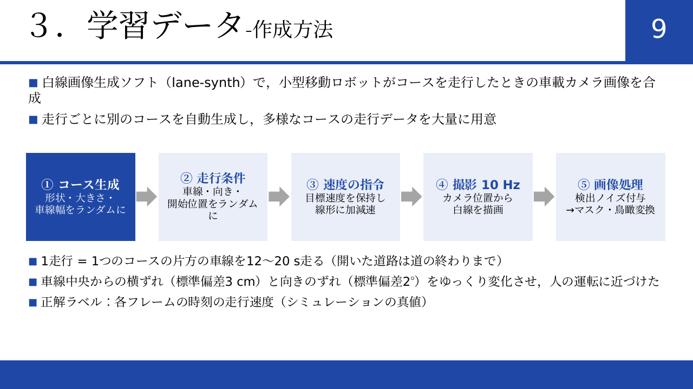

**10. 走行したコース**

**11. コースの種類と内訳**

**12. 走行の内容（速度と加減速）**

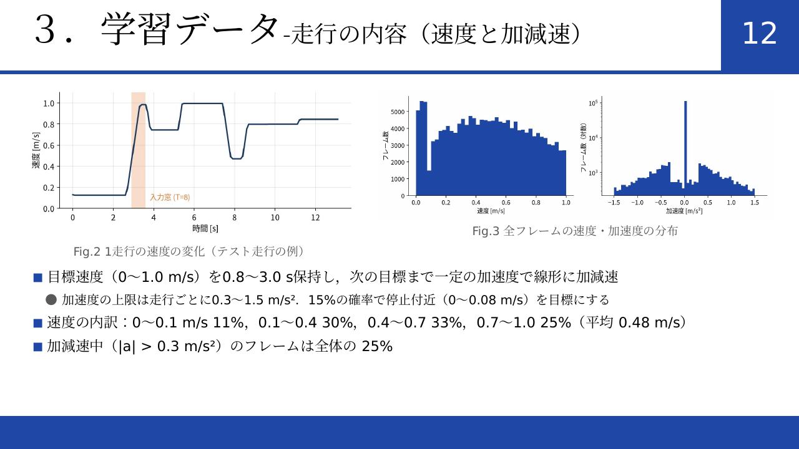

**13. データ量と分割**

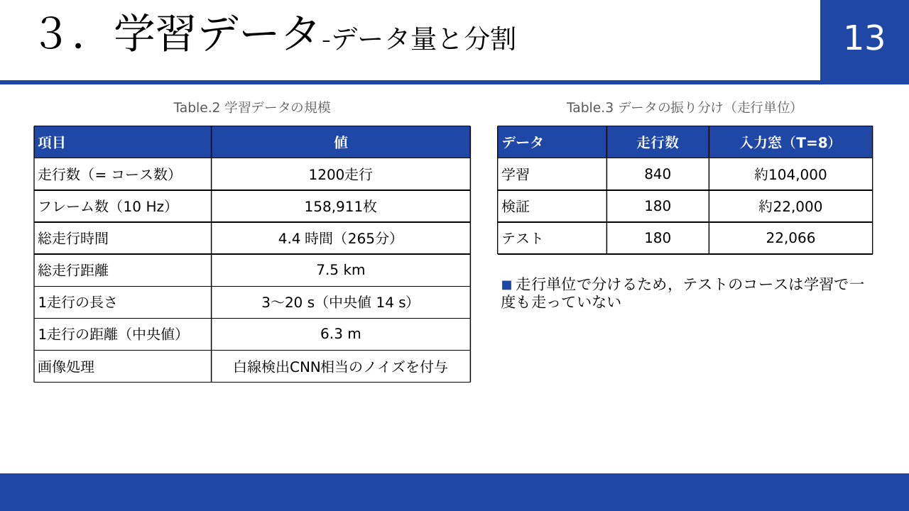

**14. 入力画像の例**

**16. 比較したNNの構造**

**17. 学習の設定**

**19. テストデータに対する推定誤差**

**20. 推定値と真の速度の関係**

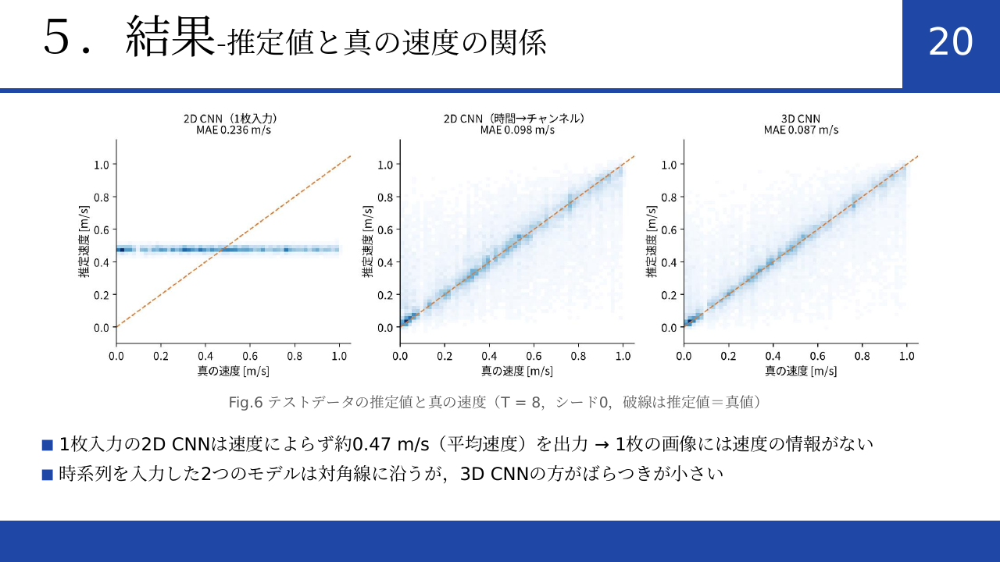

**21. 走行条件ごとの推定誤差**

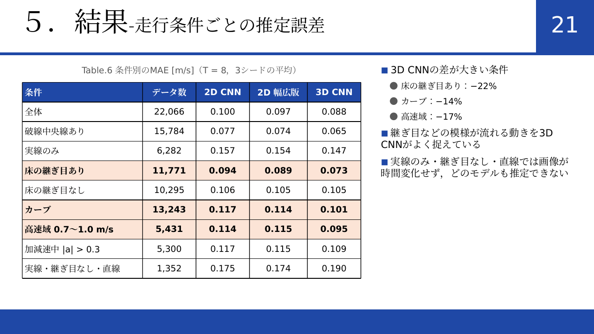

**22. 入力画像枚数Tと破線の折り返し**

**23. 鳥瞰変換の前と後の推定誤差**

**25. 考察**

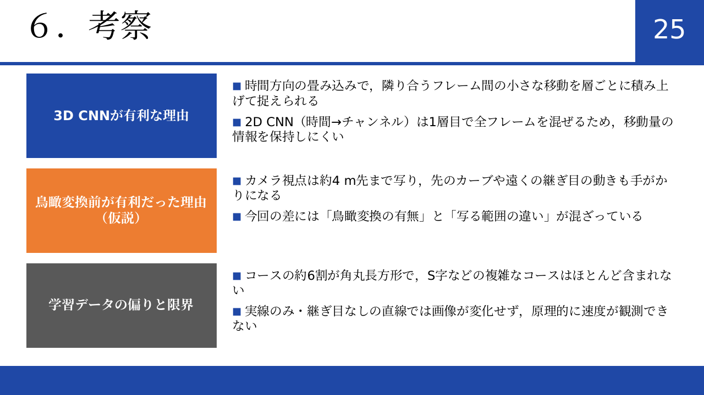

**26. まとめ**

PDF：[docs/research_v1.0.0.pdf](docs/research_v1.0.0.pdf)

## 構成

| ディレクトリ | 内容 |
|---|---|
| [projects/lane_following_dl/synth/](projects/lane_following_dl/synth/README.md) | 白線画像生成ソフト（コース生成、カメラ投影、検出ノイズ、鳥瞰変換、GUI） |
| [projects/speed_estimation_3dcnn/](projects/speed_estimation_3dcnn/README.md) | 速度推定の実験コード（データセット生成、学習、条件別評価） |
| [ros2_ws/src/](ros2_ws/src/) | ROS 2 Jazzy パッケージ（a1_bringup / a1_control / a1_vehicle） |

## 主な結果（シミュレーション、T = 8 フレーム、テスト MAE）

| モデル | 鳥瞰画像入力 | カメラ視点入力 |
|---|---|---|
| 2D CNN（1枚入力） | 0.237 m/s | — |
| 2D CNN（時間をチャンネル方向として扱う） | 0.100 m/s | 0.084 m/s |
| 3D CNN | **0.088 m/s** | **0.079 m/s** |

1 枚の画像からは速度を推定できず、時系列画像が必要です。パラメータ数・計算量をそろえても、時間方向にも畳み込む 3D CNN の誤差が最も小さくなりました。詳細はスライドを参照してください。

## ROS 2 パッケージについて

`ros2_ws/src/` のパッケージは、ロボットの制御ボード用ドライバ `ros_robot_controller`（メッセージ定義 `ros_robot_controller_msgs`）と深度カメラのドライバ `ascamera` に依存します。これらはメーカー提供のソフトウェアのため、このリポジトリには含めていません。メーカーから入手して同じワークスペースに置いてください。

## 動作環境

- 学習：Ubuntu 24.04、Python 3.12、PyTorch 2.x（CUDA）、NVIDIA GPU（RTX 4080 で確認）
- ロボット：Raspberry Pi 5、Ubuntu 24.04、ROS 2 Jazzy

## 採番

Kurihara, A. (2026). *MentorPi Research: speed estimation from time-series lane-mask images (3D-CNN vs 2D-CNN) and lane-synth* (v1.0.0) [Software]. Zenodo. https://doi.org/10.5281/zenodo.24466081

[CITATION.cff](CITATION.cff) も参照してください（GitHub の「Cite this repository」から BibTeX を取得できます）。

## ライセンス

[Apache License 2.0](LICENSE)。説明スライドも同じライセンスで公開します。

---

# English summary

Code of a personal research project on a small Ackermann-steering mobile robot (MentorPi A1 class).

- **lane-synth**: synthesizes on-board lane-mask and bird's-eye (BEV) images of a robot driving on generated courses
- **Speed estimation**: estimates the current speed from 10 Hz lane-mask sequences and compares a 3D-CNN with 2D-CNNs
  (single frame / frames stacked as channels). With matched parameters and compute, the 3D-CNN gives the lowest error
  (test MAE 0.088 m/s on BEV input, 0.079 m/s on camera-view input); a single frame cannot tell the speed (0.237 m/s).
- **ROS 2 packages** for bring-up, teleoperation and cmd_vel → motor/steering conversion. They depend on the vendor
  drivers `ros_robot_controller` and `ascamera`, which are not included.

Licensed under the Apache License 2.0.
