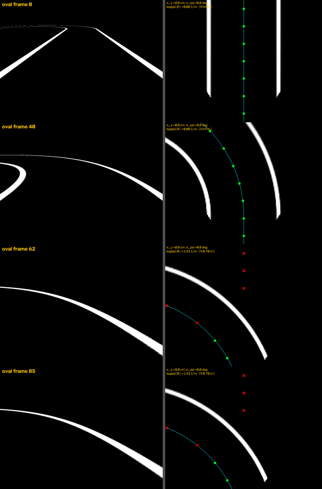
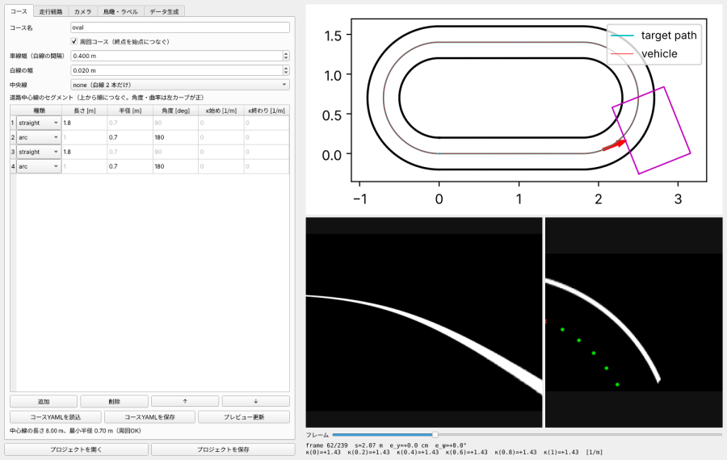
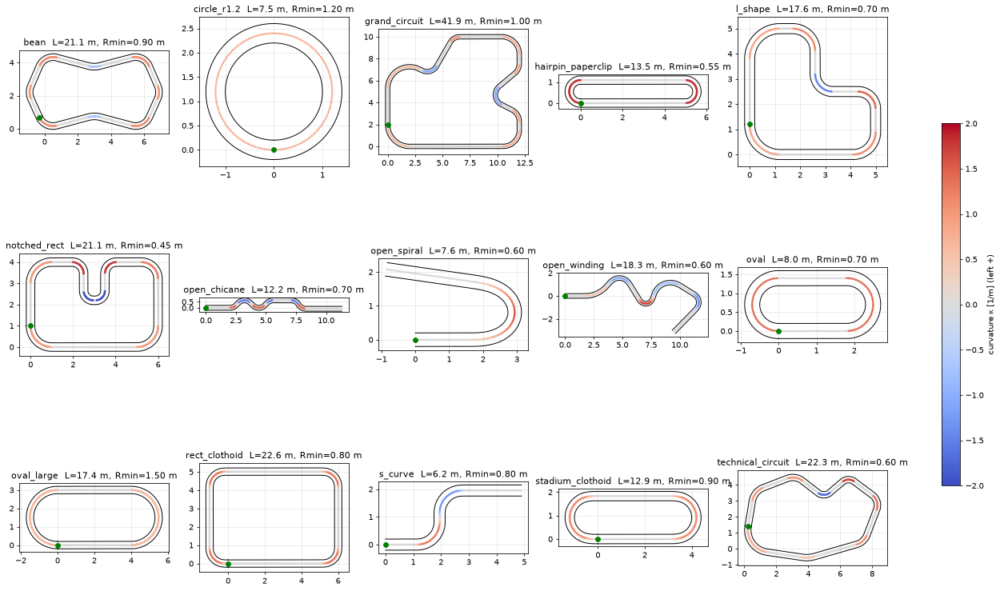

# 合成データ生成器（白線マスク → 中心線・曲率）

[← プロジェクトに戻る](../README.md)

仮想コースを仮想の A1 で走らせ、実機カメラの内部・外部パラメータで「白線検出 CNN が出すような白線マスク」を描き、鳥瞰変換した画像と正解ラベル（中心線の点列・横偏差・方位誤差・曲率）を作る。実機コースでは曲率の真値を測りにくいので、曲率 CNN はこのデータで学習する。

```
ランダムなコース ─→ 仮想走行（バイシクルモデル＋Pure Pursuit）
                     │ 真の姿勢（＋車体の揺れ・キャリブ誤差）
                     ▼
        カメラ視点の白線マスク（レイキャスト、歪み込み）
                     │ 白線検出 CNN らしい劣化（欠け・反射・ぼけ・遠方の減衰）
                     ▼
        鳥瞰画像（実機と同じ「公称」キャリブで変換）  ← 曲率 CNN の入力
        ラベル：中心線 7 点＋可視フラグ、e_y、e_ψ、κ(s)   ← 真の姿勢から幾何計算
```

オーバルコースを軌跡どおりに走らせた例（左：鳥瞰変換前のカメラ画像、右：鳥瞰変換後の画像に真の中心線（水色）とラベル点を重ねたもの。緑 = 可視、赤 × = 不可視）



## 使い方

### セットアップ（Ubuntu 22.04 / 24.04）

```bash
cd projects/lane_following_dl/synth
bash setup_ubuntu.sh     # Qt 用のシステムパッケージ・.venv・依存パッケージ・テスト・動作確認
bash run_gui.sh          # GUI を起動
```

`setup_ubuntu.sh` の中身は、`apt` で Qt の表示に必要なライブラリ（`libxcb-cursor0` など）と日本語フォントを入れ、`.venv` に `requirements.txt` を入れ、テストとオーバル 2 m の走行（`runs/check/` に画像を出力）を実行するもの。
OpenCV は `opencv-python-headless` を使う（通常版の `opencv-python` は同梱の Qt が PySide6 とぶつかることがある）。

### GUI：設定してデータセットを作る

```bash
bash run_gui.sh                        # 保存したプロジェクトを開くなら: bash run_gui.sh project.yaml
```



| タブ | 設定できること |
|---|---|
| コース | 直線・円弧・クロソイドのセグメント表、周回/開いたコース、車線幅、白線の幅、中央線の有無。コース YAML の読込・保存 |
| 走行経路 | プレビュー用の走行（向き・速度・fps・横ずれ・向きのずれ・スタート位置・距離）と、データ生成時の走行バリエーション（向き × 速度 × 横ずれ × 向きのずれ の全組合せ） |
| カメラ | 内部パラメータ（解像度・fx・fy・cx・cy・歪み）と外部パラメータ（後輪車軸中心からの位置・roll/pitch/yaw）。キャリブレーション結果（ROS の camera_info YAML か OpenCV の YAML）の読込 |
| 鳥瞰・ラベル | 鳥瞰画像の範囲・解像度、κ と中心線の点を記録する前方距離 |
| データ生成 | 生成方法（設定したコース × バリエーション／ランダムなコース）、出力フォルダ、並列数、カメラ画像も保存するか。**データ生成**ボタンで実行 |

右側はプレビュー（コースと軌跡、カメラ画像、鳥瞰画像と中心線の点、スライダーでフレームを選択、各フレームの κ・e_y・e_ψ）。

「プロジェクトを保存」で設定一式を YAML に保存できる。画面のない環境（SSH など）では同じファイルから生成できる：

```bash
python3 scripts/make_dataset.py project.yaml --workers 12
```

### データセットの中身

```
<出力フォルダ>/
  bev/00000_00000.png     鳥瞰の白線画像（曲率 CNN の入力）。ファイル名は <走行番号>_<フレーム番号>
  camera/00000_00000.png  鳥瞰変換前のカメラ画像（保存する設定のとき）
  labels.csv              1 行 = 1 画像の正解
  project.yaml            生成に使った設定一式（再現用）
  LABELS.txt              labels.csv の列の説明
```

`labels.csv` の主な列：

| 列 | 内容 |
|---|---|
| `kappa_0`, `kappa_0.2`, …, `kappa_1` | **正解ラベル κ**：車両の真横（目標経路上の最近傍点）から経路に沿って s [m] 先の目標経路の曲率 [1/m]。左カーブが正 |
| `e_y`, `e_psi` | 目標経路からの横ずれ [m]・向きのずれ [rad]（後輪車軸中心、左が正） |
| `px_<s>`, `py_<s>`, `pvalid_<s>` | 経路に沿って s 先の中心線の点（車両座標）と、画像から推定できるか（1/0） |
| `run`, `frame`, `course`, `speed`, `offset_y`, `heading_offset_deg`, `s` | どの走行のどのフレームか |

学習・検証の分割は `run`（走行）単位で行う（同じ走行の連続フレームはよく似ているため）。

### コマンドラインでのシミュレーション（1 回の走行を確認する）

```bash
# オーバルコース（中央線なし）を 0.5 m/s で 1 周
python3 scripts/simulate.py --course config/courses/oval.yaml --out runs/oval

# 中心線から 5 cm 左・5° 左向きにずらして、0.3 m/s で 3 m だけ走る
python3 scripts/simulate.py --course config/courses/oval.yaml --out runs/oval_off \
    --offset-y 0.05 --heading-offset 5 --speed 0.3 --distance 3
```

| 出力 | 内容 |
|---|---|
| `camera/000000.png` | 鳥瞰変換**前**のカメラ視点の白線画像（640×480） |
| `bev/000000.png` | 鳥瞰変換**後**の画像（180×140、5 mm/px） |
| `bev_overlay/000000.png` | 鳥瞰画像に真の中心線（水色）とラベル点（緑 = 可視、赤 × = 不可視）を重ねたもの |
| `labels.csv` | フレームごとの時刻・経路長・姿勢・ラベル |
| `course.png` | コース・軌跡・鳥瞰範囲 |

コースは `config/courses/*.yaml` に直線・円弧・クロソイドを並べて書く（`oval.yaml` は直線 1.8 m＋半径 0.7 m の半円 × 2、`s_curve.yaml` は S 字）。`--course` を省くとランダムなコースになる。

### 固定コースのセット（`config/courses/`）

実コース（オーバル）だけで学習すると、その曲率（κ = 0 と 1/0.7）しか見ないので、曲率・カーブの向き・つながり方の違うコースを用意している。仮想コースなので実寸より大きくてよい。車線幅は全コース 0.40 m、白線 0.02 m、中央線なし。



色は道路中心線の曲率 κ（赤 = 左カーブ、青 = 右カーブ）。緑の点がスタート位置。逆走（`--reverse`、データ生成の `directions: reverse`）にすると左右が入れ替わる。

| コース | 形 | 長さ | 最小半径 | ねらい |
|---|---|---|---|---|
| `oval` | 周回 | 8.0 m | 0.70 m | 実コース想定 |
| `oval_large` | 周回 | 17.4 m | 1.50 m | ゆるいカーブ・長い直線 |
| `circle_r1.2` | 周回 | 7.5 m | 1.20 m | 曲率一定を連続して見る |
| `stadium_clothoid` | 周回 | 12.9 m | 0.90 m | 直線→カーブで曲率が連続に変化（緩和曲線） |
| `rect_clothoid` | 周回 | 22.6 m | 0.80 m | 90° コーナー（緩和曲線つき） |
| `hairpin_paperclip` | 周回 | 13.5 m | 0.55 m | 180° の急カーブ |
| `notched_rect` | 周回 | 21.1 m | 0.45 m | 凹みで右カーブ・S 字。最も急なカーブ |
| `l_shape` | 周回 | 17.6 m | 0.70 m | 内角の右カーブ |
| `technical_circuit` | 周回 | 22.3 m | 0.60 m | 角度・半径の違うコーナーの組合せ |
| `grand_circuit` | 周回 | 41.9 m | 1.00 m | 13 m × 10 m の大型。高速コーナー・切り返し |
| `bean` | 周回 | 21.1 m | 0.90 m | ゆるい右カーブ（くびれ） |
| `s_curve` | 道路 | 6.2 m | 0.80 m | S 字 |
| `open_winding` | 道路 | 18.3 m | 0.60 m | 半径 0.6〜2.5 m の左右カーブをクロソイドでつなぐ |
| `open_chicane` | 道路 | 12.2 m | 0.70 m | 短い直線をはさんだ切り返し |
| `open_spiral` | 道路 | 7.6 m | 0.60 m | 曲率 0 → 1/0.6 → 0 をゆっくり変化（κ の値を連続的に網羅） |

`oval` と `s_curve` 以外は `scripts/build_courses.py` で生成している（周回コースが 1 cm 以内で閉じること、コースの別の部分と 0.52 m 以上離れていることを確認してから書き出す）。コースを変えるときは YAML ではなくスクリプトを直して再実行する：

```bash
python3 scripts/build_courses.py --check   # 確認だけ（長さ・最小半径・すき間の一覧）
python3 scripts/build_courses.py           # config/courses/*.yaml を書き出す
```

> 注意：いまの仮のカメラ設定では、半径 0.6 m 以下のカーブの奥はカメラに写らず、片側の白線しか見えないフレームがある（その点は `pvalid = 0`）。実機キャリブレーション後に見え方を確認すること。

### コースごとにデータセットを作る（`make_course_datasets.py`）

コースごとに別のフォルダへ保存する。学習・検証・テストをコース単位で分けられる（例：テストに使うコースは学習に入れない）。

```bash
# 全コース × 既定の走行パターン（中心線を順走・逆走の 2 走行/コース。下の「走行パターンの方針」）
python3 scripts/make_course_datasets.py

# コースを選ぶ・GUI で保存したプロジェクトの設定（カメラなど）を使う
python3 scripts/make_course_datasets.py --courses config/courses/oval.yaml config/courses/bean.yaml
python3 scripts/make_course_datasets.py --project project.yaml --out data/courses_v2
```

```
data/courses/
  index.csv              コース名・コース YAML・走行数・画像数・フォルダの一覧
  bean/                  1 コース分（GUI のデータセットと同じ中身）
    bev/  camera/  labels.csv  project.yaml  LABELS.txt
  circle_r1.2/
  ...
```

- 既にあるフォルダ（`labels.csv` がある）は飛ばす。作り直すときは `--overwrite`
- カメラ画像が不要なら `--no-camera`（容量が約 3 割になる）

### 走行パターンの方針（2026-11-20 時点）

**いまは「車線の中心線を走り続ける」走行だけでデータを作る**（横ずれ 0、向きのずれ 0、速度 0.5 m/s、順走と逆走）。GUI と `make_course_datasets.py` の既定値もこれにしてある。

理由：

- 曲率 CNN が出す κ(s) はそのまま MPC に渡す。どの軌道を「目標軌道」としてラベルを付けるかで、MPC が受け取る曲率が決まってしまう
- 速く走るための目標軌道（コーナーの内側を通るなど）は、車両モデル（システム同定の結果）を含めて決める必要があり、まだ決まっていない
- そのため、いまは目標軌道 = コースの中心線に固定し、ラベルの意味を一つにしておく

補足：

- `exact` モードでは速度は**フレームの間隔**を変えるだけで、画像とラベルの関係は変わらない（同じ位置なら同じ画像）。速度を複数にしても似た画像が増えるだけ
- 逆走は中心線のまま左右のカーブが入れ替わるので、左右のバランスのために残している
- 横ずれ・向きのずれは引数（`--offsets`, `--headings`）や GUI で指定すれば今も使える

今後相談すること：

- MPC に渡す目標軌道を何にするか（中心線のまま / 車両モデルから求めた最適な走行ライン / 速度に応じて変える など）
- 目標軌道から外れた位置（横ずれ・向きのずれ）の画像を学習に入れるか。入れる場合、ラベル κ は「目標軌道の曲率」のままにするか
- 走行パターンの範囲（速度・ずれの大きさ）の根拠を何にするか（実機の走行データ、システム同定の結果など）

### いまは無効にしている機能（設定で有効化できる）

| 設定 | 既定 | 内容 |
|---|---|---|
| `track.center_line` | `none` | `dashed` で中央破線ありのコース |
| `driving.mode` | `exact` | `pure_pursuit` で操舵遅れ・ノイズ・横ずれのゆらぎを入れた走行 |
| `perturb.enable` | `false` | キャリブレーション誤差・車体の揺れ |
| `detection_noise.enable` | `false` | 白線検出 CNN らしい劣化（欠け・反射・ぼけなど）と床の継ぎ目 |

### npz 形式での一括生成（旧形式）

```bash
python3 scripts/generate_dataset.py --out data/synth_v1 --num 100000 --workers 8
```

ランダムなコースで npz シャードを作る。GUI の出力（PNG＋CSV）とは別形式。

## npz 形式（`generate_dataset.py`）の中身

| キー | 形 | 内容 |
|---|---|---|
| `bev` | (N, 140, 180) uint8 | 鳥瞰の白線確率マスク。上 = 遠方（x = 1.00 m）、左 = 車両の左（y = +0.45 m）、5 mm/px |
| `y_pts` | (N, 7) float32 | 自車線の中心線の横位置 [m]。x = 0.35, 0.45, …, 0.95 m（base_link） |
| `vis` | (N, 7) uint8 | 1 = その点が前方に存在し、鳥瞰範囲内かつカメラに写っている |
| `e_y` | (N,) | 横偏差 [m]（車両が中心線の左にいると正） |
| `e_psi` | (N,) | 方位誤差 [rad]（車両の向き − 経路の向き） |
| `kappa` | (N, 6) | 曲率 [1/m]。最近傍点から s = 0, 0.2, …, 1.0 m（左カーブ正）。評価用 |
| `v`, `delta` | (N,) | 走行速度 [m/s]、実舵角 [rad] |
| `seq`, `worker` | (N,) | 走行系列の ID。学習・検証の分割は系列単位で行う（連続フレームが似ているため） |

base_link は後輪車軸中心の床面上（x 前方・y 左）。

## 中身

| ファイル | 内容 |
|---|---|
| `config/default.yaml` | カメラ・鳥瞰範囲・コース・走行・誤差・劣化のすべての設定 |
| `config/courses/` | コース定義（直線・円弧・クロソイドの並び）。15 コース |
| `scripts/build_courses.py` | 固定コースのセットを生成・検証 |
| `scripts/make_course_datasets.py` | コースごとに別フォルダへデータセットを生成 |
| `lane_synth/track.py` | コース生成。YAML のコース定義、ランダムな周回コース（角丸長方形・切り欠き・L 字・多角形）と開いた道路 |
| `lane_synth/camera.py` | カメラモデル（K・歪み・取り付け位置姿勢）、投影、画素ごとの光線 |
| `lane_synth/render.py` | コースのラスタ化（床の継ぎ目も描ける）、レイキャストによるカメラ視点マスク、鳥瞰変換、検出劣化 |
| `lane_synth/driving.py` | 仮想走行。`exact`（軌跡どおり）と `pure_pursuit`（操舵遅れ・ノイズあり） |
| `lane_synth/labels.py` | ラベル計算 |
| `lane_synth/generator.py` | 上をつないで 1 フレームずつ生成 |
| `scripts/simulate.py` | 指定コースを軌跡どおりに走らせて画像とラベルを保存 |
| `lane_synth/dataset.py` | データセット生成（GUI と `make_dataset.py` で共通） |
| `lane_synth/gui.py`, `scripts/gui.py` | GUI |

## 設計上のポイント

- **カメラ視点で描いてから鳥瞰変換する**：鳥瞰変換には実機と同じ「公称」パラメータを使う。`perturb.enable: true` にすると、描画側だけにキャリブ誤差や車体の揺れが入り、それが鳥瞰画像をどう歪めるかまで学習データに入る。
- **コース全体を描く**：隣の車線や別のコーナーの白線も写り込む。急カーブで片側の白線が見えない場面も自然に入る。
- **正解ラベル κ(s) は MPC がそのまま使う形**：車両の真横から経路に沿って s 先の曲率。あわせて e_y・e_ψ と、経路に沿った中心線の点（急カーブでも必ず存在する）も保存するので、CNN の出力を点列にしてフィット層で κ を求める構成にも使える。
- **推定できない点は `pvalid = 0`**：その点にも左右の白線にもカメラに写る部分がない場合。損失から外すこと。

## 実機に合わせて必ず置き換える値

- `camera:` の `fx, fy, cx, cy, dist`：**仮の値**。HP60C の RGB（640×480）をチェッカーボードでキャリブレーションした値にする。
- `camera:` の `xyz, rpy_deg`：**仮の値**（後輪車軸から前方 0.20 m、高さ 0.13 m、下向き 20°）。床に置いたボードで solvePnP して求める。
- `track:` の `lane_width`, `line_width`, `dash_length` などは実コースの寸法に合わせる。現在は「白線 2 本＋中央破線、1 車線 35〜40 cm」を想定。
- `bev:` と `labels.stations_x`：カメラで実際に見える範囲に合わせる。仮の取り付けでは 0.32 m より手前は写らない。

## 次にやること

1. 実機カメラのキャリブレーション → GUI のカメラタブに読み込んでデータを作り直す
2. 曲率 CNN の学習コード（入力：`bev/*.png`、正解：`labels.csv` の κ など）
3. 実機の白線検出 CNN の出力を鳥瞰変換して、合成データとの見た目の差を確認（ノイズ設計）
